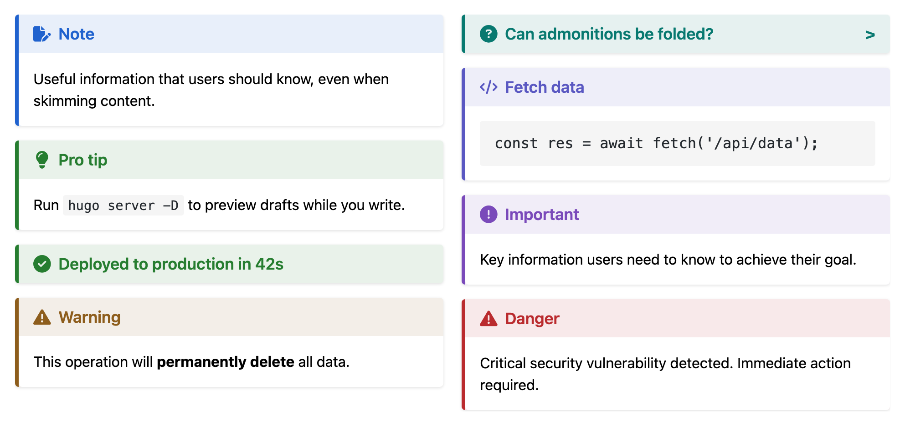
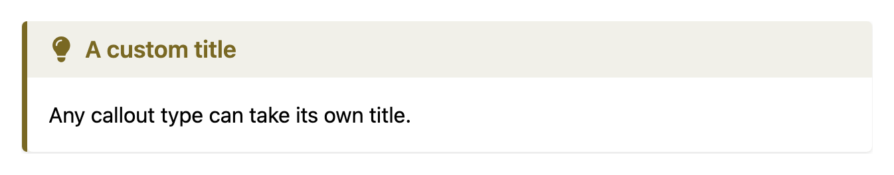
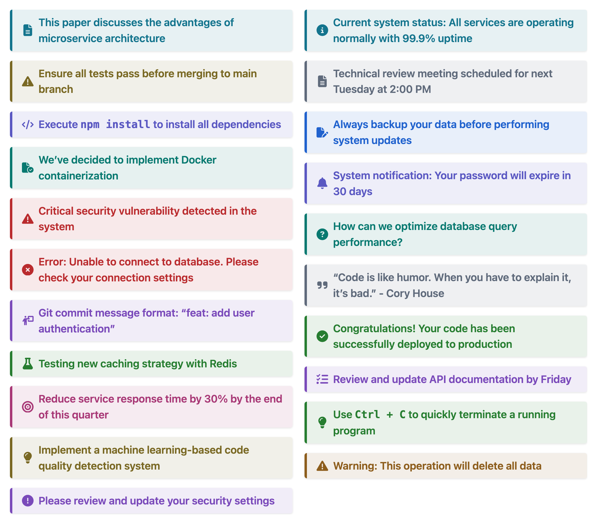
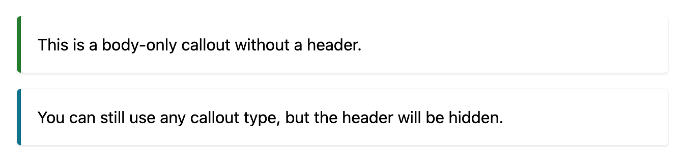
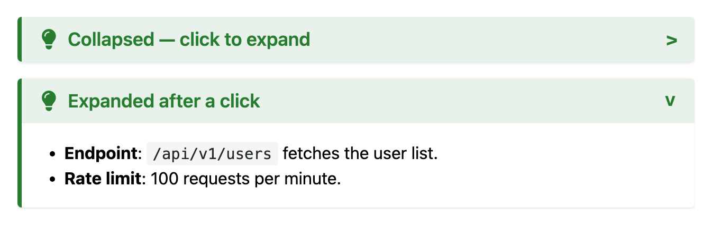
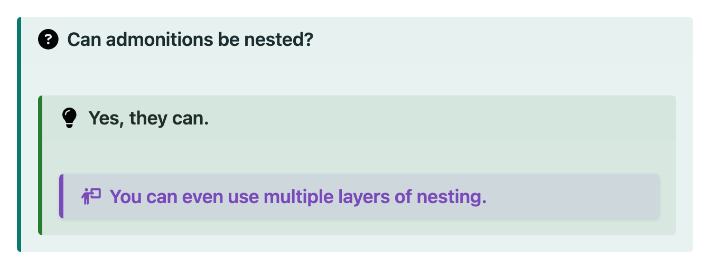
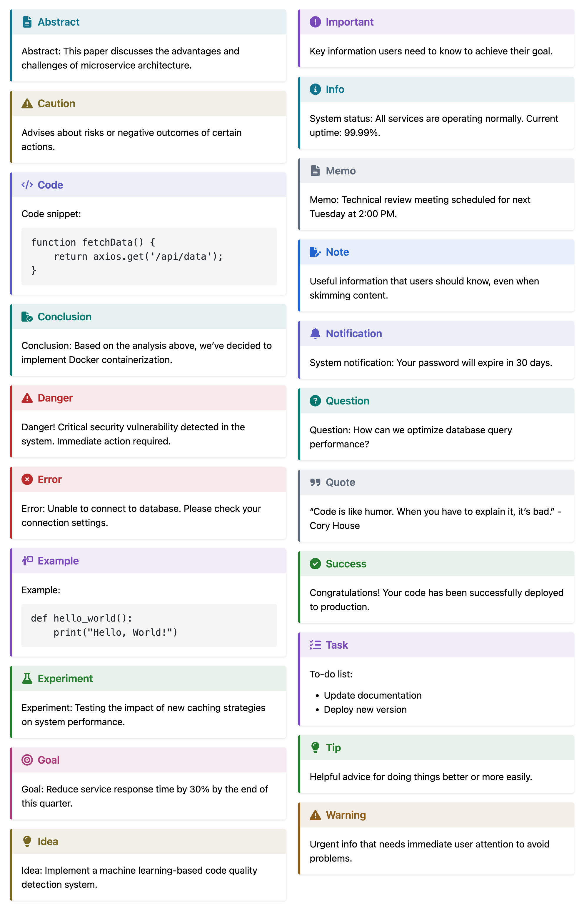

<div align="center">

# Hugo Admonitions

**Beautiful callouts for Hugo, written in plain Markdown.**

Use the same `> [!NOTE]` syntax as GitHub and Obsidian. No shortcodes, no JavaScript.

[](https://github.com/KKKZOZ/hugo-admonitions/releases)
[](https://gohugo.io)
[](https://github.com/KKKZOZ/hugo-admonitions/actions/workflows/hugo-compatibility.yml)
[](https://github.com/KKKZOZ/hugo-admonitions/blob/main/LICENSE)
[](https://github.com/KKKZOZ/hugo-admonitions/stargazers)
[](https://deepwiki.com/KKKZOZ/hugo-admonitions)

**[Live Demo](https://kkkzoz.github.io/hugo-admonitions/)** · [Quick Start](#quick-start) · [Syntax](#syntax) · [Callout Types](#callout-types) · [Customization](#customization) · [FAQ](#faq)

<br/>

<picture>
  <source media="(prefers-color-scheme: dark)" srcset="https://raw.githubusercontent.com/KKKZOZ/hugo-admonitions/main/docs/assets/images/hero-dark.png">
  
</picture>

</div>

## Why hugo-admonitions?

- **Portable Markdown.** Built on Hugo's native [blockquote render hook](https://gohugo.io/render-hooks/blockquotes/#alerts). The same file renders correctly on GitHub, Obsidian and Typora.
- **21 callout types**, each with its own icon and color. Unknown types fall back to `note`, so your build never breaks, and you can [add your own](docs/customization.md#custom-types).
- **Foldable, nested, header-only and headless** variants.
- **Light and dark mode** that follows your theme's own toggle, with no extra setup for most popular themes.
- **Works with standard Hugo.** Ships pre-compiled CSS, so you only need Sass if you want deep customization.
- **Zero cost on pages without callouts.** Styles are injected once, and only on pages that use them.
- **Localized titles** in 11 languages: English, 简体中文, 繁體中文, Čeština, Deutsch, Español, Français, 한국어, Polski, Português and Kiswahili.

## Quick Start

> [!NOTE]
> Requires **Hugo v0.140.0 or later**. Standard and Extended editions are both supported.

**1. Add the module** to your site config. Hugo Modules require [Go](https://go.dev/doc/install).

```shell
hugo mod init github.com/<you>/<your-site>   # skip if your site is already a module
```

<table>
<tr><th><code>hugo.toml</code></th><th><code>hugo.yaml</code></th></tr>
<tr><td>

```toml
[module]
  [[module.imports]]
    path = "github.com/KKKZOZ/hugo-admonitions"
  [[module.imports]]
    path = "my-theme"
```

</td><td>

```yaml
module:
  imports:
    - path: github.com/KKKZOZ/hugo-admonitions
    - path: my-theme
```

</td></tr>
</table>

```shell
hugo mod get -u
```

**2. Write a callout** in any Markdown file:

```markdown
> [!TIP]
> That's it. You're done.
```

<details>
<summary><b>Alternative: install with Git instead of Hugo Modules</b></summary>

<br/>

```shell
git submodule add https://github.com/KKKZOZ/hugo-admonitions.git themes/hugo-admonitions
```

Then put `hugo-admonitions` **first** in your theme list:

```toml
theme = ["hugo-admonitions", "my-theme"]
```

</details>

## Syntax

### Basic

```markdown
> [!NOTE]
> Useful information that users should know, even when skimming content.
```

### Custom title

Add any text after the type:

```markdown
> [!IDEA] A custom title
> Any callout type can take its own title.
```

<picture>
  <source media="(prefers-color-scheme: dark)" srcset="https://raw.githubusercontent.com/KKKZOZ/hugo-admonitions/main/docs/assets/images/custom-title-dark.png">
  
</picture>

### Header only

Leave out the body to get a compact, single-line callout:

```markdown
> [!SUCCESS] Deployed to production in 42s
```

<details>
<summary>Every type in header-only mode</summary>

<picture>
  <source media="(prefers-color-scheme: dark)" srcset="https://raw.githubusercontent.com/KKKZOZ/hugo-admonitions/main/docs/assets/images/header-only-dark.png">
  
</picture>

</details>

### Headless

Set an empty title (`""` or `''`) to hide the header and keep only the colored body:

```markdown
> [!TIP] ""
> This is a body-only callout without a header.
```

<picture>
  <source media="(prefers-color-scheme: dark)" srcset="https://raw.githubusercontent.com/KKKZOZ/hugo-admonitions/main/docs/assets/images/headless-dark.png">
  
</picture>

### Foldable

Add `-` or `+` after the type to make the callout collapsible. `-` starts collapsed and `+` starts expanded, as in Obsidian. This uses Hugo's [extended syntax](https://gohugo.io/render-hooks/blockquotes/#extended-syntax).

```markdown
> [!TIP]- Collapsed — click to expand
> Hidden until the reader asks for it.

> [!TIP]+ Expanded — click to collapse
> Visible by default, but can be folded away.
```

<picture>
  <source media="(prefers-color-scheme: dark)" srcset="https://raw.githubusercontent.com/KKKZOZ/hugo-admonitions/main/docs/assets/images/foldable-dark.png">
  
</picture>

### Nested

```markdown
> [!QUESTION] Can admonitions be nested?
> > [!TIP] Yes, they can.
> > > [!EXAMPLE] You can even use multiple layers of nesting.
```

<picture>
  <source media="(prefers-color-scheme: dark)" srcset="https://raw.githubusercontent.com/KKKZOZ/hugo-admonitions/main/docs/assets/images/nested-dark.png">
  
</picture>

## Callout Types

Type names are case-insensitive. GitHub's five alert types (`NOTE`, `TIP`, `IMPORTANT`, `WARNING`, `CAUTION`) are all included.

| Alerts & Emphasis | Information & Elaboration | Guidance & Interaction |
| --- | --- | --- |
| `DANGER` | `INFO` | `TIP` |
| `ERROR` | `NOTE` | `TASK` |
| `WARNING` | `ABSTRACT` | `GOAL` |
| `CAUTION` | `CONCLUSION` | `IDEA` |
| `IMPORTANT` | `EXAMPLE` | `QUESTION` |
| `SUCCESS` | `QUOTE` | `NOTIFY` |
| | `CODE` | |
| | `EXPERIMENT` | |
| | `MEMO` | |

Obsidian's alias names also work. Each renders as its canonical type, including that type's localized title:

| Alias | Renders as |
| --- | --- |
| `SUMMARY`, `TLDR` | `ABSTRACT` |
| `TODO` | `TASK` |
| `HINT` | `TIP` |
| `CHECK`, `DONE` | `SUCCESS` |
| `HELP`, `FAQ` | `QUESTION` |
| `ATTENTION` | `WARNING` |
| `FAIL`, `FAILURE`, `MISSING`, `BUG` | `ERROR` |
| `CITE` | `QUOTE` |

Need a type of your own? Add an icon at `layouts/partials/admonitions/icons/<type>.svg` and a color variable such as `--adm-<type>`, and `> [!<TYPE>]` works. See [Custom types](docs/customization.md#custom-types).

<details>
<summary><b>See all 21 types rendered</b></summary>

<br/>

<picture>
  <source media="(prefers-color-scheme: dark)" srcset="https://raw.githubusercontent.com/KKKZOZ/hugo-admonitions/main/docs/assets/images/overview-dark.png">
  
</picture>

</details>

## Customization

Most color tweaks need nothing more than a few CSS variables in a stylesheet that loads after the module:

```css
:root {
  --adm-note: #2563eb;            /* border, header tint, icon & title */
  --adm-header-bg-opacity: 0.15;
}
```

For more control, such as per-type header colors, dark-mode selectors or a full SCSS override, see the **[Customization Guide](https://github.com/KKKZOZ/hugo-admonitions/blob/main/docs/customization.md)**.

## FAQ

<details>
<summary><b>Colors look wrong on my deployed site, but fine locally</b></summary>

<br/>

Your CI is almost certainly running a Hugo version older than `0.140.0`. Check the `HUGO_VERSION` in your deployment workflow (usually under `.github/workflows/`) and bump it.

</details>

<details>
<summary><b>Callouts stay light when my site switches to dark mode</b></summary>

<br/>

By default the module follows your theme's dark-mode toggle (for example `html[data-theme="dark"]`, `.dark` or `data-bs-theme`), not the operating system setting. If your theme uses a selector that isn't in the default list, see [Dark mode](https://github.com/KKKZOZ/hugo-admonitions/blob/main/docs/customization.md#dark-mode) in the Customization Guide. To follow the OS setting as well, set `darkMode = "auto"` under `[params.hugoAdmonitions]` ([details](https://github.com/KKKZOZ/hugo-admonitions/blob/main/docs/customization.md#following-the-system-setting)).

</details>

<details>
<summary><b>Do I need Hugo Extended or Dart Sass?</b></summary>

<br/>

No. Pre-compiled CSS is used by default. You only need Dart Sass if you opt in to [Sass-based customization](https://github.com/KKKZOZ/hugo-admonitions/blob/main/docs/customization.md#2-sass-variable-overrides).

</details>

## Contributing

Contributions are welcome, especially [new translations](https://github.com/KKKZOZ/hugo-admonitions/tree/main/i18n). Feel free to open an [issue](https://github.com/KKKZOZ/hugo-admonitions/issues) or a [pull request](https://github.com/KKKZOZ/hugo-admonitions/pulls).

<details>
<summary>Development setup</summary>

<br/>

```shell
npm install                                   # installs the commit-message hook
bash tests/hugo-compat/test.sh precompiled    # run the compatibility checks
bash tests/hugo-compat/test.sh scss           # requires Dart Sass in PATH
```

Commit messages must follow [Conventional Commits](https://www.conventionalcommits.org/en/v1.0.0/). Releases are generated from them automatically.

</details>

## Acknowledgements

Inspired by [mdbook-admonish](https://tommilligan.github.io/mdbook-admonish/). Icons from [Font Awesome](https://fontawesome.com/).

## License

Released under the [MIT License](https://github.com/KKKZOZ/hugo-admonitions/blob/main/LICENSE).

## Star History

If this project helps you, please consider giving it a ⭐. It really helps!

<a href="https://www.star-history.com/#KKKZOZ/hugo-admonitions&Date">
 <picture>
   <source media="(prefers-color-scheme: dark)" srcset="https://api.star-history.com/svg?repos=KKKZOZ/hugo-admonitions&type=Date&theme=dark" />
   <source media="(prefers-color-scheme: light)" srcset="https://api.star-history.com/svg?repos=KKKZOZ/hugo-admonitions&type=Date" />
   
 </picture>
</a>
